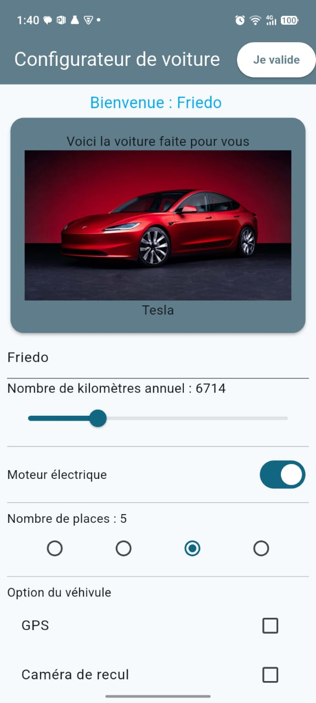
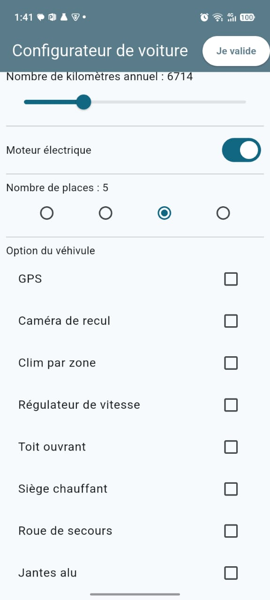

# 🚗 Config Voiture App Flutter

<p align="center">
  <strong>Configurateur de voiture développé avec Flutter</strong>
</p>

<p align="center">
  Une application mobile qui recommande une voiture selon le moteur, le nombre de places et le kilométrage annuel de l'utilisateur.
</p>

## 📌 Présentation

**Config Voiture App Flutter** est une application mobile réalisée avec Flutter et Dart. L'utilisateur saisit son nom, indique son kilométrage annuel, choisit un type de moteur et un nombre de places, puis l'application lui présente une voiture parmi huit modèles, accompagnée d'un conseil adapté à son usage.

Le projet a été réalisé comme exercice du cours *Flutter & Dart - L'essentiel* (Udemy). Son objectif principal est de réutiliser les widgets interactifs de Flutter dans une seule interface.

## ✨ Fonctionnalités

- **Message de bienvenue** avec le nom saisi, mis à jour au clic sur « Je valide » (`TextField` + `TextEditingController`)
- **Kilométrage annuel** de 0 à 25 000 km (`Slider`)
- **Type de moteur** électrique ou thermique (`Switch`)
- **Nombre de places** : 2, 4, 5 ou 7 (`Radio` dans un `RadioGroup`)
- **Options du véhicule** : GPS, caméra de recul, clim par zone, régulateur de vitesse, toit ouvrant, siège chauffant, roue de secours, jantes alu (`CheckboxListTile`). Ces options sont purement interactives et n'influencent pas la recommandation.
- **Carte résultat** (`Card`) qui affiche un message, l'image et le nom de la voiture recommandée, et qui se met à jour à chaque changement
- **Bouton « Je valide »** dans l'`AppBar` : il ferme le clavier et met à jour le message de bienvenue

## 🧠 Logique de recommandation

### Message affiché selon le moteur et le kilométrage

| Condition | Message |
|---|---|
| 15 000 km ou plus **et** moteur électrique | « Vous devriez penser à un moteur thermique compte tenu du nombre de kilomètres » |
| 5 000 km ou moins **et** moteur thermique | « Vous faites peu de kilomètres, pensez à regarder les voitures électriques » |
| Autres cas | « Voici la voiture faite pour vous » |

### Voiture recommandée selon le moteur et le nombre de places

| Moteur | 2 places | 4 places | 5 places | 7 places |
|---|---|---|---|---|
| Électrique | MG Cyberster | R5 électrique | Tesla | Van VW |
| Thermique | Alpine | Fiat 500 | Peugeot 3008 | Dacia Jogger |

La recherche est faite avec `firstWhere` sur la liste de voitures (classe `Car`) en comparant le type de moteur et le nombre de places.

## 🛠️ Technologies utilisées

| Technologie | Utilisation |
|---|---|
| [Flutter](https://flutter.dev/) | Développement multiplateforme |
| [Dart](https://dart.dev/) | Langage de programmation |
| Material Design | Widgets de l'interface |
| Git et GitHub | Gestion de versions et hébergement du code |

## 📷 Aperçu de l'application

<p align="center">
  
  
</p>

## 🚀 Installation et exécution

### Prérequis

- Flutter SDK installé et configuré
- Dart SDK (fourni avec Flutter)
- Android Studio ou Visual Studio Code
- Un émulateur Android ou un appareil compatible

### Étapes

**1. Cloner le dépôt**

```bash
git clone https://github.com/KifK2f/config_voiture_app_flutter.git
```

**2. Accéder au projet**

```bash
cd config_voiture_app_flutter
```

**3. Installer les dépendances**

```bash
flutter pub get
```

**4. Lancer l'application**

```bash
flutter run
```

### Images de l'application

Les images des voitures se trouvent dans `assets/images/` et sont déclarées dans `pubspec.yaml` :

```yaml
flutter:
  assets:
    - assets/images/
```

## 📁 Structure du projet

```text
config_voiture_app_flutter/
├── assets/
│   └── images/          # Images des voitures
├── lib/
│   ├── main.dart        # Point d'entrée et thème
│   └── home_page.dart   # Page principale et classe Car
├── screenshots/         # Captures d'écran du README
├── pubspec.yaml
└── README.md
```

## 🎯 Objectifs du projet

- Réutiliser les widgets interactifs de Flutter (`TextField`, `Slider`, `Switch`, `Radio`, `Checkbox`)
- Gérer l'état d'une page avec un `StatefulWidget` et `setState`
- Modéliser des données avec une classe Dart (`Car`) et les filtrer dans une liste
- Afficher un résultat dynamique dans une `Card`

## 👨‍💻 Auteur

**FIANYO Kodzovi Friedo**

- GitHub : [@KifK2f](https://github.com/KifK2f)

---

<p align="center">
  Développé avec Flutter et Dart.
</p>